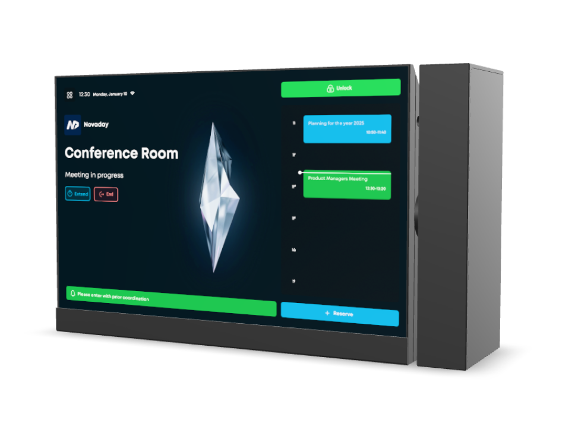
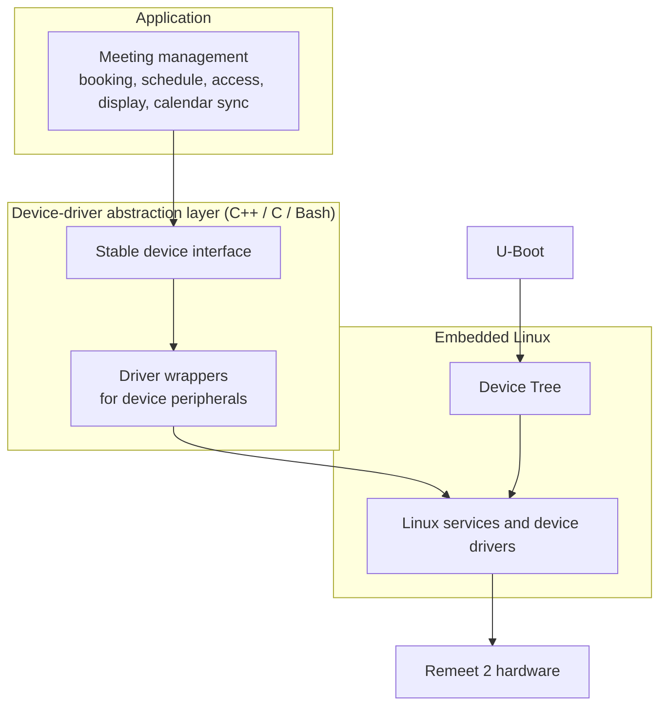

<h1 align="center">Remeet 2</h1>
<h3 align="center">IoT meeting-room panel with RFID, NFC, and fingerprint access, battery backup, and calendar integration</h3>

  

> **Remeet 2** is the second generation of the Remeet meeting-room panel, mounted beside doors. It shows room status and schedules, authenticates users with RFID, NFC, or fingerprint, and keeps running on battery when mains power is lost. The vertical display connects to Outlook, Google, and other calendar platforms.
>
> As **Senior Embedded Systems (IoT) Engineer** at [Novaday Co.](https://novaday.ir/), I designed the hardware and engineered the embedded software for Remeet 2, from PCB design through firmware, the Embedded Linux platform, and the device-driver layer that connects application code to the hardware. Remeet 2 is a commercial product of Novaday.

---

## My Role

**Senior Embedded Systems (IoT) Engineer**, [Novaday Co.](https://novaday.ir/)

I was the hands-on engineer behind Remeet 2, responsible for the hardware design, the embedded software, and the platform work that turns the device into a meeting-management product. The product itself is owned by Novaday Co.

| Area | What I did |
|------|------------|
| **Hardware design** | Designed the Remeet 2 PCB and electronics, including RFID, NFC, and fingerprint sensing, battery backup, and a vertical display |
| **Platform customization** | Customized the Remeet 2 platform for meeting management, covering room booking, schedules, access control, and on-device room information |
| **Device-driver layer** | Created a **C++ / C / Bash device-driver abstraction layer** that bridges application developers with low-level Linux services, **Device Tree**, and **U-Boot** |
| **Embedded software** | Engineered the device software in C/C++ on embedded Linux, from boot configuration to application features |

**Skills**

| Category | Expertise |
|----------|-----------|
| **Hardware** | PCB design · Hardware design · RFID / NFC · Fingerprint sensing · Battery backup · ARM Cortex |
| **Embedded Linux** | Embedded Linux · Device Tree · U-Boot · Device drivers · Driver abstraction layers |
| **Firmware** | Embedded C / C++ · Bare-metal firmware |
| **IoT** | IoT connectivity · Calendar integration (Outlook, Google) · Cloud and on-premise deployment |
| **Tooling** | Bash · Build and system scripting |

---

## Product at a Glance

Remeet 2 turns any meeting room into a managed space. The vertical display sits beside the door and shows who is using the room now and what is coming next. People book rooms from their calendar platform, a mobile app, or the web, and the same system unlocks the door. Users authenticate with an RFID card, an NFC device, or a fingerprint, so no keys or phone calls are needed to coordinate a meeting.

---

## Key Features

**What is new in Remeet 2**
- **RFID, NFC, and fingerprint authentication** on the device
- **Battery backup** keeps the panel running during a power outage
- **Vertical display** instead of the horizontal layout in Remeet 1
- **Calendar integration** with Outlook, Google, and other calendar platforms

**Meetings and rooms**
- Reserve meetings from the device, the mobile app, or the web app
- Meeting types: confidential, recurring, one-on-one, and group
- Room capacity limits, with a warning when the attendee count is exceeded
- Attendee lists and guest invitations with attendance tracking
- Personal, room, and colleague calendars, with meeting reminders and in-meeting chat

**Access control**
- Unlock the door remotely from the app or web
- Per-user access levels set by the organization
- RFID, NFC, and fingerprint credentials, plus QR-code unlocking with movement logged per participant
- Per-device passwords, so the door can be opened from the device keypad even without the software

**Display and branding**
- Shows the company logo, room name, date, time, and current meeting
- Custom messages for welcome greetings, reminders, or meeting information
- Solar and Gregorian calendars, and time-zone aware scheduling

**Platform**
- Manage multiple companies, branches, or business units in one environment
- Android, iOS, and web applications
- Six languages: Persian, English, German, Arabic, Turkish, and French
- Cloud or on-premise server, depending on the organization's needs

---

## Hardware

| Parameter | Value |
|-----------|-------|
| Display orientation | Vertical |
| Authentication | RFID, NFC, fingerprint, and QR code |
| Power | Mains supply with battery backup |
| Connectivity | Wi-Fi or LAN |
| Calendar integration | Outlook, Google, and other calendar platforms |

---

## Device Software Architecture

Application code does not talk to the hardware directly. The driver abstraction layer sits between the meeting-management application and the Linux kernel. Application developers call a stable interface, and the layer handles the Linux services, Device Tree bindings, and boot-time configuration underneath.

| Layer | Technology | Role |
|-------|------------|------|
| Application | C++ | Meeting management, calendar sync, and device features |
| Abstraction layer | C++, C | Hides low-level device access behind one interface |
| Tooling | Bash | Build and system-level helper scripts |
| Linux | Device Tree, kernel drivers | Hardware description and device access |
| Boot | U-Boot | Bootloader and boot-time device setup |

---

## Note on Confidentiality

This repository is a **portfolio description** of my work on Remeet 2. I **cannot publish the schematics or the source code** because of copyright. Both belong to **[Novaday Co.](https://novaday.ir/)**, the company that owns the Remeet product, and all rights are reserved.

The public materials in this repository are the only parts shared here. To order a device or request a consultation, use the official product page:

- Company: <https://novaday.ir/>
- Order and product preview: <https://remeet.ir/pages/preview.html>
- Product documentation: <https://docs.remeet.ir>

---

## Contact

**Pourya Afshintabar**, Senior Embedded Systems (IoT) Engineer · Vienna, Austria

Embedded C/C++ · Embedded Linux · Bare-metal (ARM Cortex-M) · IoT · Hardware design

- Email: pouryaafshintabar@gmail.com
- GitHub: [PATEmbedded](https://github.com/PATEmbedded)
- LinkedIn: [pourya-afshintabar](https://www.linkedin.com/in/pourya-afshintabar/)
