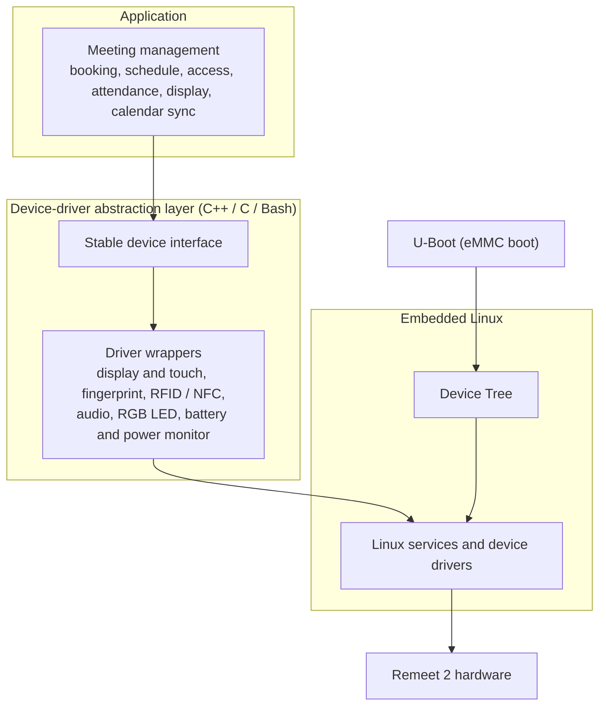
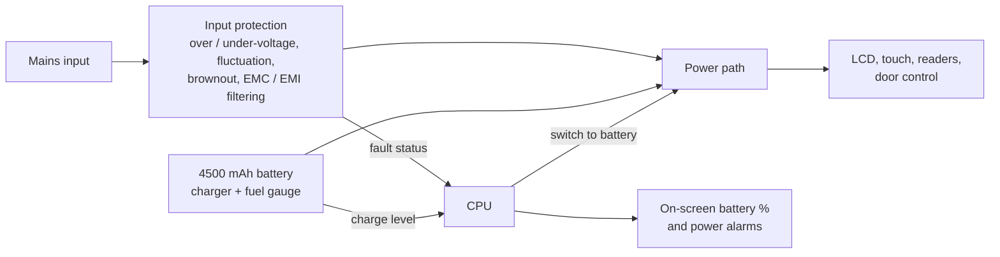
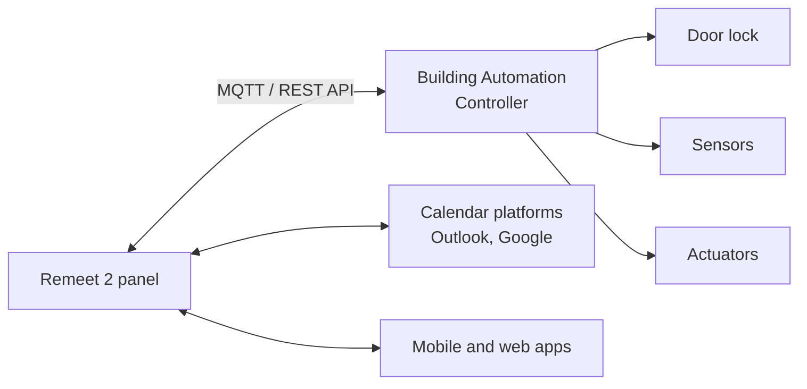

<h1 align="center">Remeet 2</h1>
<h3 align="center">IoT meeting-room panel with fingerprint, RFID, and NFC access, smart battery backup, themed lighting, voice audio, and calendar integration</h3>

  

> **Remeet 2** is the second generation of the Remeet meeting-room panel, mounted beside doors. It shows room status and schedules, authenticates users by fingerprint, RFID, or NFC, controls the door, and keeps running for about three hours on its own battery when mains power is lost. The vertical display connects to Outlook, Google, and other calendar platforms.
>
> As **Senior Embedded Systems Engineer** at [Novaday Co.](https://novaday.ir/), I led the redesign from Remeet 1 to Remeet 2. I designed the **complete hardware end to end**, including **two PCBs built from scratch on my own system architecture**. I programmed **every low-level sensor and actuator** and wrote the drivers that expose them to the backend. I also developed a major part of the embedded software, covering firmware, the Embedded Linux platform, boot optimization, and the device-driver layer, and **led the product's IoT networking**. Remeet 2 is a commercial product of Novaday.

---

## Table of Contents

- [My Role](#my-role)
- [Remeet 1 vs. Remeet 2](#remeet-1-vs-remeet-2)
- [Engineering Highlights](#engineering-highlights)
- [Product at a Glance](#product-at-a-glance)
- [Key Features](#key-features)
- [Hardware](#hardware)
- [System Architecture](#system-architecture)
- [Impact Summary](#impact-summary)
- [Note on Confidentiality](#note-on-confidentiality)
- [Contact](#contact)

---

## My Role

**Senior Embedded Systems Engineer**, [Novaday Co.](https://novaday.ir/)

I was the hands-on engineer behind Remeet 2. I owned the hardware **from concept to production**, wrote the low-level software for every sensor and actuator, developed a major part of the embedded software, and led the IoT networking that connects the device to the rest of the platform. The product itself is owned by Novaday Co.

| Area | What I did |
|------|------------|
| **System architecture** | Defined the hardware architecture of Remeet 2 myself, from block diagram and component selection to the split between boards |
| **Hardware design (end to end)** | Designed **two PCBs from scratch** and carried all hardware work from schematic and layout through bring-up and testing: fingerprint, RFID, and NFC readers, a rotatable vertical display, stereo audio, high-power RGB lighting, and onboard eMMC storage |
| **Power electronics** | Designed the battery backup, charging, and fuel-gauge circuits, plus a protected input power stage with fault reporting to the CPU and stricter EMC/EMI design |
| **Mechanical consolidation** | Replaced two left-hand and right-hand product variants with a single design that fits either side of the door |
| **Embedded Linux and boot** | Moved boot to onboard eMMC and tuned the kernel and system initialization to cut boot time |
| **Device-driver layer** | Created a **C++ / C / Bash device-driver abstraction layer** that bridges application developers with low-level Linux services, **Device Tree**, and **U-Boot** |
| **Low-level sensor and actuator software** | Programmed **every sensor and actuator** in the device's lower layer and wrote backend-ready drivers for each one, so the application and backend teams use them through a clean interface |
| **Embedded software** | Developed a major part of the device software in C/C++ on embedded Linux, including the fingerprint, RFID, and NFC readers, power and battery monitoring, audio, lighting, and display orientation |
| **IoT networking** | Led all IoT networking work for the product, including device connectivity and messaging over **MQTT** and **REST API** |
| **Building Automation Controller** | Built the **Building Automation Controller**, a companion networked I/O device, and connected it to Remeet 2 for sensor, actuator, and door control |

**Skills**

| Category | Expertise |
|----------|-----------|
| **Hardware** | System architecture · Schematic and PCB design from scratch · Board bring-up · RFID / NFC · Fingerprint sensing · Audio · High-power RGB LED drivers · ARM Cortex |
| **Power electronics** | Battery backup · Charging and fuel gauge · Input protection · Power-fault detection · EMC / EMI design |
| **Embedded Linux** | Embedded Linux · Device Tree · U-Boot · eMMC boot · Boot-time optimization · Sensor and actuator drivers · Driver abstraction layers |
| **Firmware** | Embedded C / C++ · Bare-metal firmware |
| **IoT** | IoT networking · MQTT · REST API · IoT connectivity · Calendar integration (Outlook, Google) · Cloud and on-premise deployment |
| **Tooling** | Bash · Build and system scripting |

---

## Remeet 1 vs. Remeet 2

Remeet 2 was a redesign of the full product, covering the hardware, power system, mechanics, and embedded software. The table summarizes the main changes.

| Area | Remeet 1 | Remeet 2 |
|------|----------|----------|
| **Display** | Horizontal LCD | Vertical LCD and touchscreen; rotates to suit left-hand or right-hand doors |
| **Product variants** | Two variants, one for each door side, with separate molds, PCBs, CNC programs, and enclosures | **One product** for both door sides |
| **Power outage** | Shuts down when mains power is lost | **4500 mAh battery** keeps the full system running for about **3 hours** |
| **Battery status** | — | Charging and fuel-gauge circuit, with battery percentage shown on screen |
| **Input power** | Standard supply | Protected input with over-voltage, under-voltage, fluctuation, brownout, and insufficient-current detection; stricter EMC/EMI design |
| **Power intelligence** | — | CPU receives power-fault status, alerts the user, and can switch the device to battery |
| **Authentication** | QR code and password on the touchscreen keypad | **Fingerprint**, **RFID**, and **NFC** (phone tap), plus QR code and touchscreen password |
| **Boot** | Slow boot | Boots from **onboard eMMC**, with an optimized kernel and system initialization |
| **Audio** | — | **2 × 2.5 W stereo speakers** for voice announcements, alerts, chimes, and music |
| **Lighting** | — | **High-power RGB LED** with intense, vivid light that follows the room theme |
| **Expansion** | — | Syncs with the **Building Automation Controller** over MQTT / REST API for sensors, actuators, and remote commands |

---

## Engineering Highlights

### 1. One product for left-hand and right-hand doors

**Challenge.** Some doors open from the left and others from the right, so the partition column beside the door can be on either side. Remeet 1 needed two separate products, each with its own mold, PCB, CNC program, enclosure, and mounting design. This doubled tooling, manufacturing, and inventory costs.

**What I did.** I moved the display from a horizontal to a vertical layout and designed the electronics and enclosure to be symmetric. The installer rotates the unit to suit the door, and the device adjusts the LCD and touchscreen orientation automatically.

**Result.** One product, one PCB, and one set of tooling now cover every installation. The installer chooses the mounting side on site, with no special hardware needed.

### 2. Battery backup for power outages

**Challenge.** Meeting rooms and server rooms need working door access even during a power outage. Many server rooms have no UPS, and outages there are usually fixed within two to three hours.

**What I did.** I added a 4500 mAh battery with a dedicated charging and management circuit, sized to run the entire device for about three hours. That covers the LCD, the touchscreen, the authentication readers, and door control. A fuel-gauge circuit measures the charge level, and the firmware shows the battery percentage on screen.

**Result.** The panel stays on and keeps controlling doors through typical outages, so people can still enter rooms until power returns.

### 3. Protected and monitored input power

**Challenge.** Mains power at customer sites can be unstable, with fluctuations, voltage drops, and over-voltage events.

**What I did.** I designed a protected input stage that detects over-voltage, under-voltage, voltage fluctuation, brownouts, and insufficient supply current. I also tightened the EMC/EMI design. The hardware reports each fault condition to the CPU. The software then raises an alarm on screen and, when needed, cuts the mains input and continues on battery.

**Result.** The device protects itself from bad power, tells the user when supply quality is a problem, and switches to battery on its own.

### 4. Faster boot with onboard eMMC

**Challenge.** Remeet 1 booted slowly, which delayed the panel after every restart or power cycle.

**What I did.** I added onboard eMMC storage so the system boots from fast internal flash. I also optimized the boot chain, including U-Boot, the kernel configuration, and system initialization.

**Result.** The device boots noticeably faster and is ready for use sooner after a restart.

### 5. Fingerprint, RFID, and NFC authentication

**Challenge.** Remeet 1 supported only a QR code or a password typed on the touchscreen keypad, which limited how users could identify themselves at the door.

**What I did.** I integrated a fingerprint sensor and RFID/NFC readers. I wrote the software that reads a user's credentials from a card, a fingerprint, or a phone held near the panel.

**Result.** Users can open the door, start a meeting, or change entry and exit settings without keys. Some customer organizations also used Remeet 2 as an **employee time-and-attendance terminal**, which made fingerprint support a major selling point.

### 6. Stereo audio and themed RGB lighting

**What I did.** I added two 2.5 W stereo speakers that play voice announcements, alerts, chimes, and music. I also added a high-power RGB LED with an intense, vivid output that the user can set to match the room theme.

**Result.** The panel now gives spoken and audible feedback, and its lighting matches the look of each room.

### 7. Building Automation Controller integration

**What I did.** I also designed the **Building Automation Controller**, a separate networked I/O device. Remeet 2 syncs with it and sends it commands over **MQTT** or **REST API**. Beyond door control, the controller reads sensors and drives actuators, much like a PLC I/O module but connected over IP.

**Result.** A single meeting-room panel can also handle wider room and building automation.

---

## Product at a Glance

Remeet 2 turns any meeting room into a managed space. The vertical display sits beside the door and shows who is using the room now and what is coming next. People book rooms from their calendar platform, a mobile app, or the web, and the same system unlocks the door. Users authenticate with a fingerprint, an RFID card, or an NFC-enabled phone, so no keys or phone calls are needed to coordinate a meeting. If mains power fails, the panel keeps working on its own battery.

---

## Key Features

**What is new in Remeet 2**
- **Fingerprint, RFID, and NFC authentication** on the device
- **Smart battery backup**: about 3 hours of full operation, with the battery level shown on screen
- **Protected input power** with fault detection and automatic switch-over to battery
- **One rotatable vertical design** for both left-hand and right-hand doors
- **Fast boot** from onboard eMMC
- **2 × 2.5 W stereo speakers** for voice announcements, alerts, chimes, and music
- **High-power RGB LED** with intense, vivid light that follows the room theme
- **Building Automation Controller integration** over MQTT and REST API
- **Calendar integration** with Outlook, Google, and other calendar platforms

**Meetings and rooms**
- Reserve meetings from the device, the mobile app, or the web app
- Meeting types: confidential, recurring, one-on-one, and group
- Room capacity limits, with a warning when the attendee count is exceeded
- Attendee lists and guest invitations with attendance tracking
- Personal, room, and colleague calendars, with meeting reminders and in-meeting chat

**Access control and attendance**
- Unlock the door remotely from the app or web
- Per-user access levels set by the organization
- Fingerprint, RFID, and NFC credentials, plus QR-code unlocking with movement logged per participant
- Can be used as an employee time-and-attendance terminal
- Per-device passwords entered on the touchscreen keypad, so the door can be opened even without the software

**Display, lighting, and sound**
- Shows the company logo, room name, date, time, and current meeting
- Custom messages for welcome greetings, reminders, or meeting information
- Solar and Gregorian calendars, and time-zone aware scheduling
- High-power RGB LED lighting set to match the room theme
- Spoken voice prompts, alert tones, chimes, and music through stereo speakers

**Power and reliability**
- About 3 hours of runtime on the 4500 mAh battery during a power outage
- On-screen battery percentage and power-fault alarms
- Detection of over-voltage, under-voltage, fluctuation, brownout, and insufficient current on the mains input

**Platform**
- Manage multiple companies, branches, or business units in one environment
- Android, iOS, and web applications
- Six languages: Persian, English, German, Arabic, Turkish, and French
- Cloud or on-premise server, depending on the organization's needs

---

## Hardware

| Parameter | Value |
|-----------|-------|
| Display | Vertical LCD with touchscreen; orientation adjusts for left-hand or right-hand mounting |
| Authentication | Fingerprint, RFID, NFC, QR code, and password on the touchscreen keypad |
| Storage | Onboard eMMC (boot and system) |
| Battery | 4500 mAh, about 3 hours of full operation, with charger and fuel gauge |
| Power input | Mains supply with over-voltage, under-voltage, fluctuation, brownout, and current-fault detection; EMC/EMI-hardened design |
| Audio | Stereo, 2 × 2.5 W speakers |
| Lighting | High-power RGB LED with intense, vivid output, themed to the room |
| Connectivity | Wi-Fi or LAN |
| Integration | Building Automation Controller over MQTT / REST API |
| Calendar integration | Outlook, Google, and other calendar platforms |

---

## System Architecture

### Device software

Application code does not talk to the hardware directly. The driver abstraction layer sits between the meeting-management application and the Linux kernel. Application developers call a stable interface, and the layer handles the Linux services, Device Tree bindings, and boot-time configuration underneath.

| Layer | Technology | Role |
|-------|------------|------|
| Application | C++ | Meeting management, calendar sync, and device features |
| Abstraction layer | C++, C | Hides low-level device access behind one interface |
| Tooling | Bash | Build and system-level helper scripts |
| Linux | Device Tree, kernel drivers | Hardware description and device access |
| Boot | U-Boot on eMMC | Fast bootloader and boot-time device setup |

### Power management

### Room integration

---

## Impact Summary

- Designed the **complete Remeet 2 hardware end to end**, including **two PCBs built from scratch** on a system architecture I defined.
- Programmed **every low-level sensor and actuator** and wrote backend-ready drivers for each one.
- Led the **IoT networking** for the product and developed a major part of the embedded software.
- Merged two left-hand and right-hand product variants into **one rotatable design**, removing duplicate molds, PCBs, CNC programs, and enclosures and roughly halving the related tooling costs.
- Designed a **4500 mAh battery backup** that runs the full system for about **3 hours** during outages, with charging, a fuel gauge, and on-screen battery status.
- Built a **protected, monitored power input** with hardware fault reporting to the CPU and automatic switch-over to battery, and tightened the EMC/EMI design.
- Cut **boot time** by moving to onboard eMMC and optimizing U-Boot, the kernel, and system initialization.
- Integrated **fingerprint, RFID, and NFC** authentication. Customers also adopted the device as a time-and-attendance terminal.
- Added **2 × 2.5 W stereo voice and audio output** and **themed high-power RGB lighting**.
- Designed the **Building Automation Controller** and connected it to Remeet 2 over **MQTT / REST API** for sensor, actuator, and door automation.
- Wrote a **C++ / C / Bash device-driver abstraction layer** that gives application developers a stable interface to the hardware.

---

## Note on Confidentiality

This repository is a **portfolio description** of my work on Remeet 2. I **cannot publish the schematics or the source code** because of copyright. Both belong to **[Novaday Co.](https://novaday.ir/)**, the company that owns the Remeet product, and all rights are reserved.

The public materials in this repository are the only parts shared here. To order a device or request a consultation, use the official product page:

- Company: <https://novaday.ir/>
- Order and product preview: <https://remeet.ir/pages/preview.html>
- Product documentation: <https://docs.remeet.ir>

---

## Contact

**Pourya Afshintabar**, Senior Embedded Systems Engineer · Vienna, Austria

Embedded C/C++ · Embedded Linux · Bare-metal (ARM Cortex-M) · IoT · Hardware design · Power electronics

- Email: pouryaafshintabar@gmail.com
- GitHub: [PATEmbedded](https://github.com/PATEmbedded)
- LinkedIn: [pourya-afshintabar](https://www.linkedin.com/in/pourya-afshintabar/)
